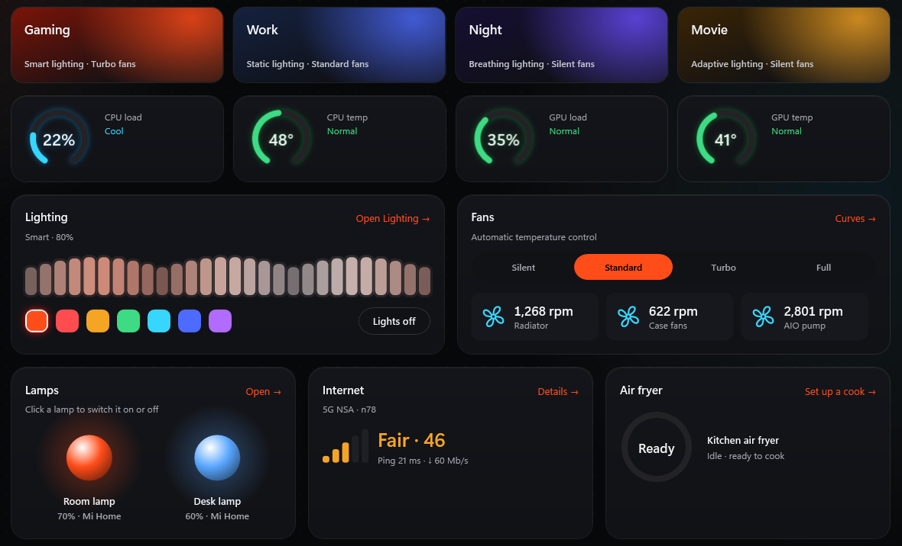
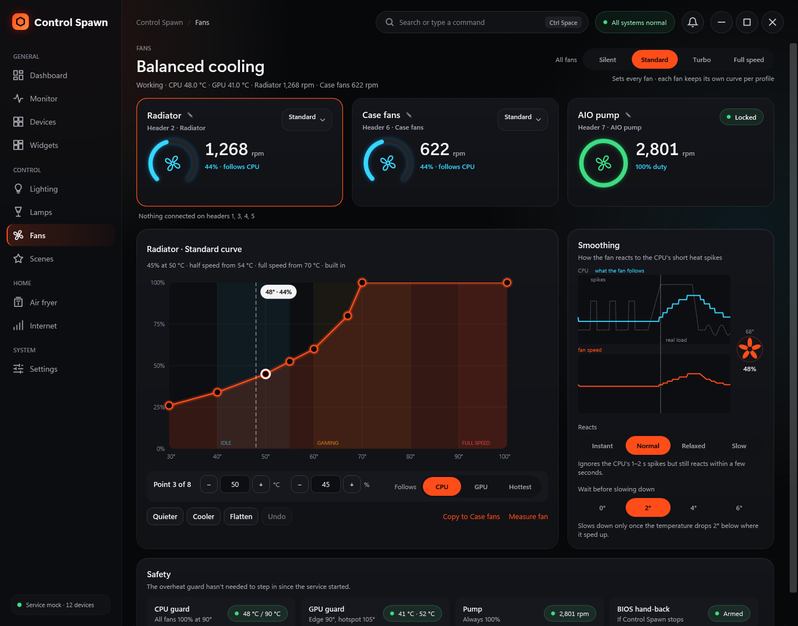
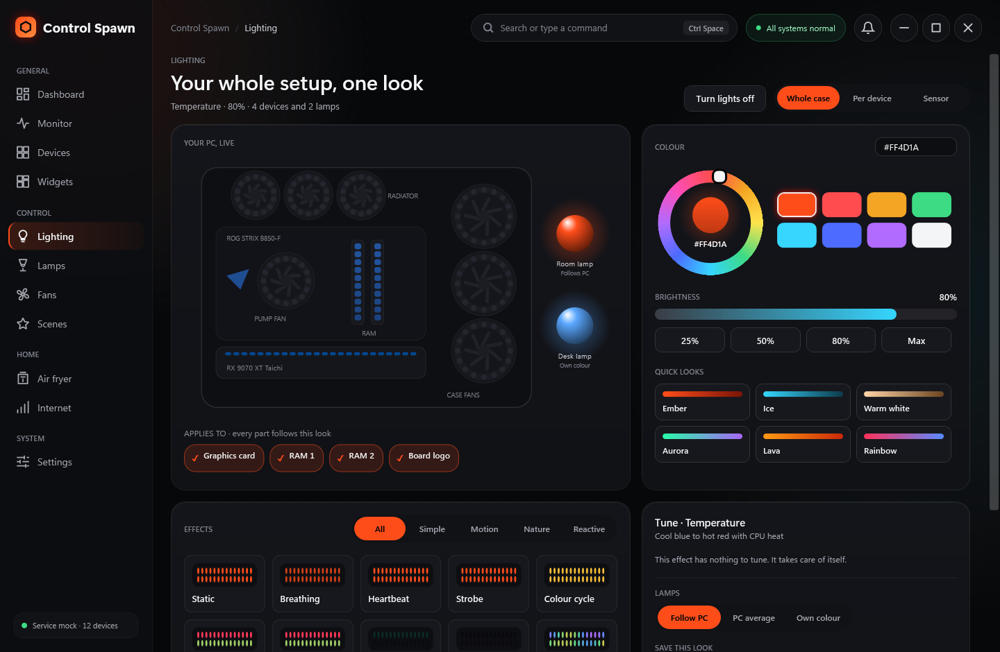
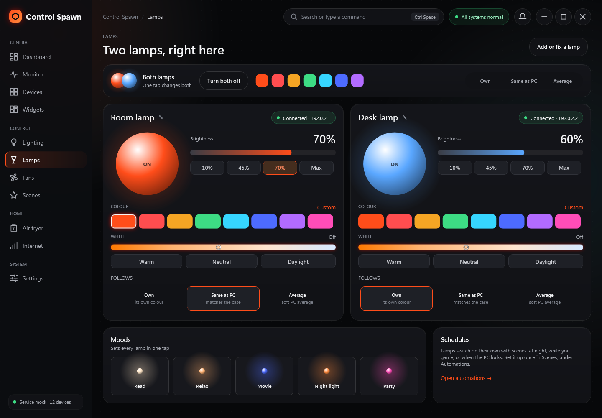
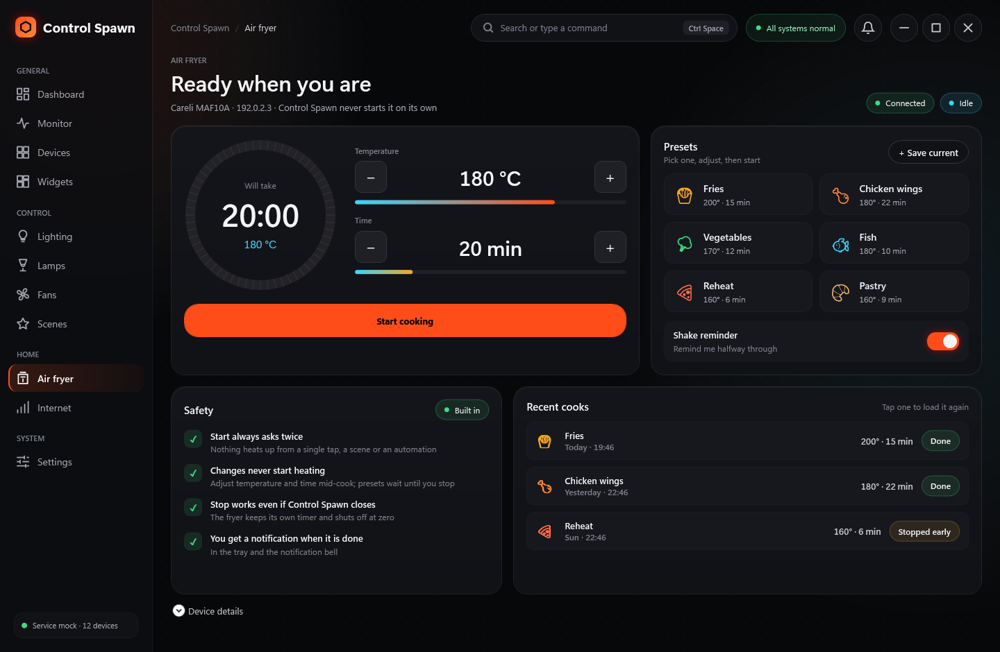
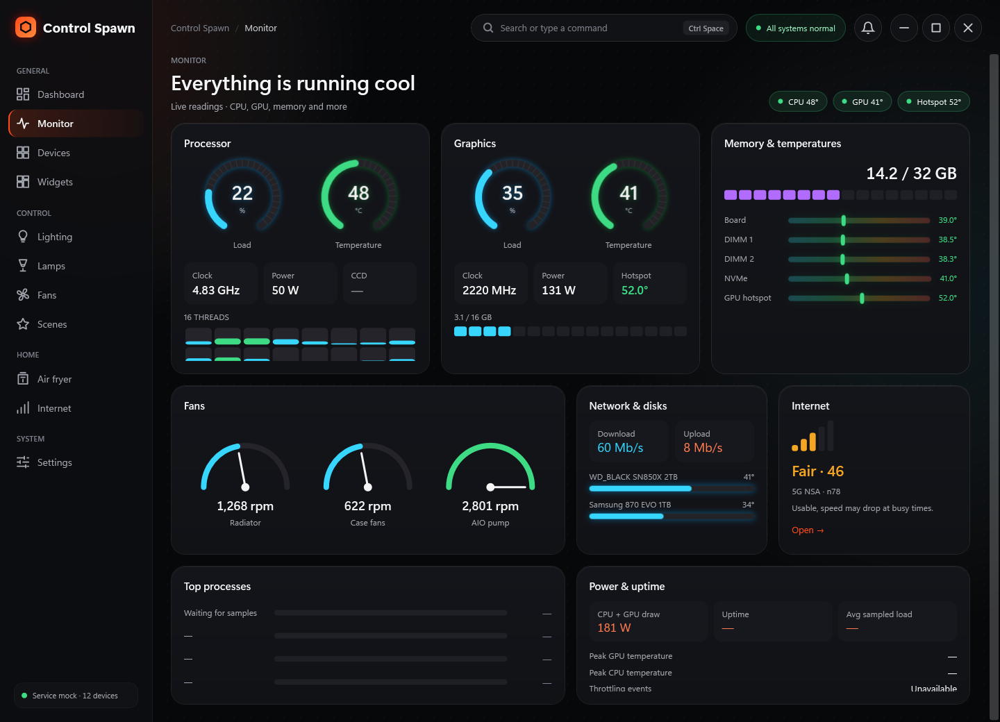

<div align="center">


# Control Spawn

**One Windows control centre for your gaming PC and the room around it.**
Fans, case RGB, Mi Home lamps, the air fryer and the 5G router, in one app.
It replaces ASUS Armoury Crate and Corsair iCUE.

[](https://github.com/HarDvolT/control-spawn/releases/latest)
[](#requirements)
[](https://dotnet.microsoft.com/)

### [⬇ Download ControlSpawnSetup.exe](https://github.com/HarDvolT/control-spawn/releases/latest)

</div>

<p align="center">
  
</p>

---

## Contents

- [What it does](#what-it-does)
- [Screenshots](#screenshots)
- [Install](#install)
- [Requirements](#requirements)
- [How it works](#how-it-works)
- [Safety](#safety)
- [Build from source](#build-from-source)
- [Project layout](#project-layout)
- [Third-party software](#third-party-software)

## What it does

| | |
|---|---|
| **Fans** | Silent, Standard, Turbo and Full modes, or your own curves. Live RPM for the radiator, case fans and AIO pump. |
| **Case lighting** | Effects across every fan and strip through OpenRGB, laid out the way the fans sit in the case. Lighting can follow CPU or GPU temperature. |
| **Lamps** | Yeelight / Mi Home colour bulbs. Turn them on and off, set colour and white, or let them follow the PC lighting. |
| **Air fryer** | Careli MAF10A. Pick a preset or set time and temperature, start, pause, resume and stop. Change time and temperature while it cooks. Keeps a list of recent cooks. |
| **Internet** | Signal of the ZLT 5G router (RSRP, SINR, band), ping and speed, with a plain verdict. |
| **Monitor** | CPU, GPU, memory and drive sensors in one place. |
| **Scenes** | Gaming, Work, Night and Movie set lighting and fans together in one click. |
| **Desktop widgets** | Small always-on-top cards for CPU, GPU, fans, lighting, lamps, the modem and more. |
| **Tray** | Closing the window keeps it in the tray. The background service keeps running with no window open. |

## Screenshots

<table>
  <tr>
    <td width="50%"><p align="center"><b>Fans</b></p></td>
    <td width="50%"><p align="center"><b>Lighting</b></p></td>
  </tr>
  <tr>
    <td width="50%"><p align="center"><b>Lamps</b></p></td>
    <td width="50%"><p align="center"><b>Air fryer</b></p></td>
  </tr>
  <tr>
    <td colspan="2"><p align="center"><b>Monitor</b></p></td>
  </tr>
</table>

## Install

1. Download **`ControlSpawnSetup.exe`** from the [latest release](https://github.com/HarDvolT/control-spawn/releases/latest).
2. Run it and accept the administrator prompt.
3. If Armoury Crate or iCUE services are found, the installer offers to stop and disable them so they don't fight over the fans and lights. They are not uninstalled, and uninstalling Control Spawn puts them back the way they were.
4. Pick whether Control Spawn opens in the tray when you sign in. The background service always starts with Windows.
5. Open **Devices** in the app to add your lamps and air fryer (sign in with your Xiaomi account, or paste a token).

> [!TIP]
> In your BIOS, turn off **Download & Install ARMOURY CRATE app**, or Windows will put the ASUS software back.

To uninstall, use **Settings → Apps → Installed apps → Control Spawn**.

## Requirements

- Windows 11, 64-bit, desktop edition.
- Administrator rights to install (the service reads sensors and drives fans).
- Microsoft Visual C++ Runtime x64 for case lighting. Most gaming PCs already have it. The installer tells you if it's missing: [vc_redist.x64.exe](https://aka.ms/vs/17/release/vc_redist.x64.exe).
- Nothing else. .NET, OpenRGB and the PawnIO driver come in the installer.

> [!NOTE]
> Control Spawn was built for and tested on one PC: an ASUS ROG STRIX B850-F with a Ryzen 7 9800X3D and an RX 9070 XT, two Yeelight bulbs, a Careli air fryer and a ZLT 5G router. Fans and RGB on other boards work through LibreHardwareMonitor and OpenRGB, but haven't been tested. See [docs/HARDWARE.md](docs/HARDWARE.md).

## How it works

```
 ┌──────────────────────────┐        named pipe         ┌───────────────────────────┐
 │  Control Spawn app       │  ◄── state, 1 per sec ──  │  Prism service            │
 │  window, tray, widgets   │  ── commands ──────────►  │  runs at boot, as admin   │
 │  (per user, no admin)    │        \\.\pipe\prism     │                           │
 └──────────────────────────┘                           │  fans, sensors   ─ LibreHardwareMonitor + PawnIO
                                                        │  case RGB        ─ OpenRGB (TCP 6742)
                                                        │  lamps, fryer    ─ Mi Home / Yeelight on the LAN
                                                        │  router          ─ ZLT web API (read only)
                                                        └───────────────────────────┘
```

Only the service talks to hardware, so admin rights live in one place. The app and widgets just show what the service sends and pass your clicks back. Fans, lighting and automations keep running when the window is closed or nobody is signed in.

## Safety

- The AIO pump always runs at 100%. It can't be changed from the app.
- If the CPU or GPU reaches 90 °C, or the sensors fail three times in a row, every fan goes to 100%.
- No fan setting goes below its minimum.
- If the service stops or crashes, fan control goes back to the BIOS.
- The air fryer asks before it starts or resumes, and won't start while it's offline or already cooking.
- The router is only read, never changed. Passwords and tokens are stored with Windows DPAPI.

## Build from source

You need the [.NET 8 SDK](https://dotnet.microsoft.com/download/dotnet/8.0).

```powershell
dotnet build Prism.sln -c Debug
dotnet test Prism.sln -c Debug
```

Run the service with fake hardware, then start the app and it connects to it:

```powershell
src\Prism.Service\bin\Debug\net8.0-windows\Prism.Service.exe --mock --console
```

Build the installer (needs [Inno Setup 6](https://jrsoftware.org/isinfo.php)). It downloads OpenRGB and PawnIO, checks their hashes against `build/dependencies.json`, and writes `build/out/ControlSpawnSetup.exe`:

```powershell
powershell -ExecutionPolicy Bypass -File build\publish.ps1
```

## Project layout

The product is called Control Spawn. The code still uses its working name, **Prism**.

| Folder | What's in it |
|---|---|
| `src/Prism.Core` | Shared models and the pipe contract between app and service |
| `src/Prism.Hardware` | Sensors and fan control (LibreHardwareMonitor) |
| `src/Prism.Lighting` | OpenRGB client, effects, sensor lighting, Mi Home and Yeelight |
| `src/Prism.Router` | ZLT 5G router client |
| `src/Prism.Service` | Background service, lighting loop, automations, air fryer |
| `src/Prism.App` | WPF app, tray and desktop widgets |
| `tests/` | xUnit tests, plus an offscreen renderer for app pages |
| `installer/`, `build/` | Inno Setup installer and the publish script |
| `docs/` | Design language, hardware notes, architecture |

## Third-party software

The installer bundles, unmodified:

- **[OpenRGB 1.1](https://codeberg.org/OpenRGB/OpenRGB/releases/tag/release_1.1)**, GPL-2.0. Its licence files ship with it.
- **[PawnIO 2.2.0](https://github.com/namazso/PawnIO.Setup/releases/tag/2.2.0)**, the signed driver LibreHardwareMonitor uses for sensors and fans. It is shared with other apps, so uninstalling Control Spawn leaves it in place.

Full notices: [installer/THIRD-PARTY-NOTICES.txt](installer/THIRD-PARTY-NOTICES.txt).

Not affiliated with ASUS, Corsair, Xiaomi, Yeelight, Careli or ZLT.
