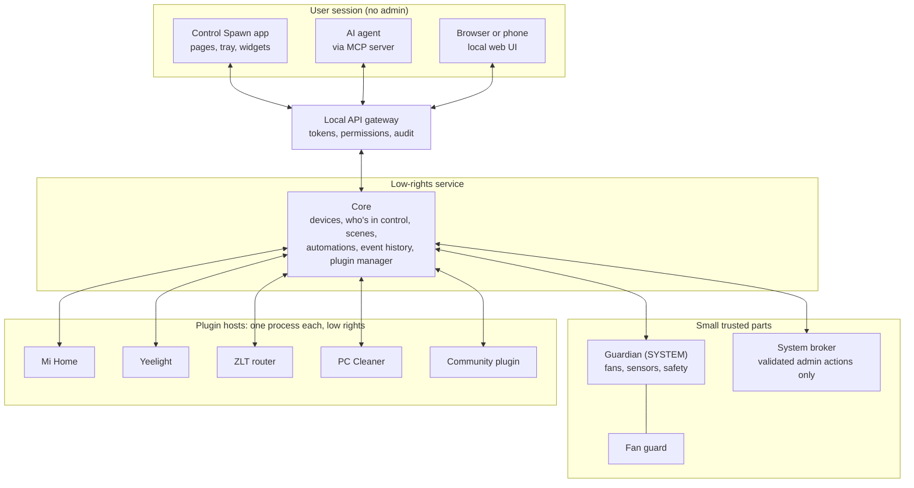

# Control Spawn: the platform plan

The plan to turn Control Spawn from one person's PC tool into an open, modular, all-in-one manager for any Windows PC and the home around it. It is built from plugins, open to contributors, and able to be run and extended by AI agents.

Status: draft for the owner's review, 2026-11-05. Written against `ui/v2-pages` at `58f142a`, then revised after an architecture review the same day. Sections marked **Decision** need the owner's call.

---

## 1. The idea

**Control Spawn is one local app that runs your whole setup: PC hardware, PC health, network, and the devices in your room. You install only what you need, and you or your AI agent can change anything.**

Today people need a stack of apps that don't talk to each other: a vendor RGB suite, a fan tool, a cleaner, a process tuner, a network limiter, a smart-home app per brand. Each one is bloated, separate, or asks for an account. Control Spawn replaces the stack with one fast core and a plugin for everything else.

What makes it different:

| Promise | What it means in practice |
|---|---|
| **Local first** | No account, no cloud, no ads. Works offline. Telemetry is off unless you opt in. |
| **Small core, your choice of plugins** | A clean install is fans, sensors, safety and the plugin manager. Everything else is optional. |
| **Everything works together** | A lamp from any brand joins scenes, automations and the dashboard the moment its plugin is installed. |
| **Safe by design** | Plugins can't reach your fans' safety logic. A crashing plugin can't crash the app. Every system change can be previewed and undone. |
| **Honest** | No fake "PC health score", no scare tactics, no registry cleaner. It shows measured results or nothing. |
| **Open** | Open source, with public plugin rules and public review. |
| **Agent ready** | Any AI agent can read state, run actions and build new plugins, within permissions you set. |

### Who it's for

1. **PC enthusiasts** who want to drop Armoury Crate, iCUE and similar suites. This is the first audience, and the one that spreads the word.
2. **Everyday PC owners** who want one trustworthy tool for cleanup, startup and speed.
3. **Smart-room and home-lab people** who want their PC and devices to act together.
4. **AI agent users**, a new group: people who want to say "make my PC quiet at night" and have it happen.
5. **Contributors**: hardware owners, plugin authors, translators and designers.

---

## 2. Where the code stands today

The base is stronger than a typical first release, and the gaps are clear.

**Already right, and worth keeping:**

- Three layers: an elevated service, a per-user app and a separate fan guard. Only the service touches hardware.
- Modules that fail alone: each `HostedModule` has its own retry loop, and one failure doesn't stop the others.
- A real IPC boundary: the app talks to the service through a versioned JSON pipe (`PipeContract`, `ProtocolVersion = 1`). Unverified clients are read-only.
- A device list with capabilities already started: `DeviceState` has `Kind` and `Capabilities`.
- Data-driven device support already started: the fryer is described by spec files such as `Specs/careli.fryer.maf10a.json`.
- Interfaces and mocks for hardware: `IHardwareMonitor`, `IFanController`, `IRgbBackend`, `ILampClient`, plus `--mock`.
- Fan safety, a secret store, a live-tested upgrade path, and 657 tests.

**Blocking "universal":**

| Problem | Where |
|---|---|
| Fan headers 2, 6 and 7 are hardcoded as Radiator, Case fans and pump | `LhmHardwareMonitor.cs:180`, `FanController.cs:54`, `StallWatch.cs:12`, `FanModule.cs:30` |
| Exactly two fan groups are required, and settings fail validation otherwise | `Settings.cs:104`, `CommandProcessor.cs:542`, `StateAssembler.cs:64` |
| The app assumes those two groups in at least five places | `MainViewModel`, `WidgetViewModel`, `DashboardViewModel`, `FansViewModel` |
| Only ASUS and Corsair conflicts are known | `AsusServiceCheck.cs`, `Prism.iss` |
| The case picture and lighting split assume the owner's layout | `CaseIllustration.cs`, `SpatialEffects.cs:107` |
| The pump warning assumes a pump that idles near 2,800 rpm | `StallWatch.cs` |
| The router client is ZLT only, with no general router interface | `Prism.Router` |

**Blocking "modular":**

| Problem | Where |
|---|---|
| Modules are a fixed list compiled into the service | `ServiceRuntime.cs:264` |
| Pages are a closed enum | `Navigation/Pages.cs`, `PageKey` |
| Commands are a fixed list of about 45 names, each handled in the service | `Commands`, `CommandProcessor` (547 lines) |
| State is one fixed record with fields per feature | `StateMessage` |
| Core interfaces know about Mi Home types | `IServiceRuntime` |
| Fryer code lives in the lighting project, and the app references that project directly | `Prism.Lighting`, `Prism.App.csproj` |
| LAN device protocols run inside the SYSTEM service | `ServiceRuntime.cs:578-598`, `DeviceDiscovery.cs` |
| Every module runs as SYSTEM, though fans and sensors look like the only ones that need it | `ServiceRuntime.cs:264` |
| Nothing decides who wins when several features want the same device | No shared rule across scenes, automations and events |
| Device status has no reason and no "slow" state | `DeviceStatus` in `DeviceContract.cs` |

**Blocking "open to the public":**

| Problem | Effect |
|---|---|
| **No licence file** | By default nobody can legally reuse or contribute. This must be fixed first. |
| **.NET 8 support ends on November 10, 2026** | Every project targets it. Installed copies keep running, but get no more security fixes. Move to .NET 10, supported until November 2028. |
| No CI | Quality depends on one PC. |
| Unsigned releases | Windows SmartScreen warns on every download. `publish.ps1` can sign, but has no certificate. |
| No auto-update | Security fixes can't reach users. |
| No CONTRIBUTING, SECURITY or issue templates | Nobody knows how to help. |
| No translation support | English only, with text written directly in the code. |
| `ARCHITECTURE.md` is out of date | It still describes WinUI 3 and old rules, and tells people not to commit. |
| Two flaky tests | CI would fail at random. |
| No diagnostics export | A user on another PC can't report what they have. |

---

## 3. The target architecture

### 3.1 The one big idea: capabilities, not features

**Plugins bring devices and tools. The core brings the experience.**

Your request named lamps and air fryers as plugins. They're better split a different way, because a lamp is a *kind of device*, while a plugin is an *ecosystem or protocol*:

- The **Mi Home plugin** gives you Xiaomi lamps *and* the fryer, because they share one protocol, one token system and one discovery method. They already share `MiioLampClient` today.
- A **Philips Hue plugin** would add lamps to the *same* Lamps page.
- Scenes, automations, the dashboard, widgets and agents all work with "a light", not with "a Yeelight".

So every device exposes standard capabilities:

| Capability | Examples |
|---|---|
| `sensor` | Temperatures, load, power, air quality |
| `fan` | Speed, curve, mode |
| `leds` | Addressable LED strips and zones |
| `pointer` | Mouse DPI stages, polling rate, buttons, lift-off distance |
| `keyboard` | Key remapping, layers, macros, polling rate |
| `headset` | Equalizer, mic, sidetone, noise cancelling, auto power-off |
| `battery` | Charge level, charging state |
| `light` | On/off, brightness, colour, white temperature |
| `switch` | Smart plugs |
| `appliance` | Fryer programs, always with confirmed starts |
| `network` | Signal, usage, speed |
| `media`, `climate`, `camera`, `lock` | Later |

The rule: **no feature in the core may name a brand.** New capabilities go through an RFC.

### 3.2 Process model



The app uses the same local API as agents and scripts, with full rights. That keeps one way in, and one place to check permissions.

Trust levels:

| Level | What runs there | Rights | Who can ship it |
|---|---|---|---|
| **Guardian** | Fans, sensors, safety | SYSTEM | Core maintainers only |
| **Core** | Devices, scenes, automations, event history, plugin manager, gateway | Low-rights service account | Core maintainers only |
| **Broker** | A short, fixed list of admin actions | Admin, one validated action at a time | Core maintainers only |
| **Official plugin** | Mi Home, Cleaner, Network tools | Low rights, separate process | Project, signed |
| **Community plugin** | Anything reviewed through the registry | Tightest sandbox, declared permissions | Anyone, reviewed |
| **Local plugin** | Plugins you or your agent wrote | Sandbox, with a clear "not reviewed" label | You, on your PC only |

**Why split the service in two?** Today every module runs as SYSTEM. An earlier draft of this plan kept scenes, automations and the plugin manager there too, which was a mistake: a bug in any of them would have full control of the PC. So the service splits:

- **Guardian** runs as SYSTEM and does only fans, sensors and safety. It stays small, rarely changes, and is easy to review.
- **Core** runs with low rights and does everything else. Core asks for fan changes. The Guardian applies its limits first.
- **Fan curves run in the Guardian**, so fans keep following their last curve if Core crashes or updates.
- **If the Guardian dies**, the fan guard hands the fans back to the BIOS, as it does today.
- **Anything that needs the user's desktop**, such as screen colours, runs in a per-user process.
- **The `ControlSpawn` service key stays with the Guardian**, so upgrades keep working.

**Why not load plugin DLLs into the service?** It's the easy route, and it's the wrong one. A plugin DLL inside a SYSTEM service gets full control of the PC, can crash fan control, and can read every secret. Out-of-process hosting costs more work now and is what makes open contribution safe. It also improves today's product, because LAN parsing leaves the SYSTEM process.

### 3.3 The plugin system

**A plugin is a folder:**

```text
com.controlspawn.mihome/
  plugin.json        identity, version, permissions, what it provides
  backend/           the process that runs
  ui/                optional pages
  locales/           translations
  specs/             data files
  README.md
```

**Manifest example:**

```json
{
  "id": "com.controlspawn.mihome",
  "name": "Mi Home",
  "version": "1.2.0",
  "publisher": "Control Spawn",
  "sdk": "^1.0",
  "category": "smart-home",
  "platforms": ["windows-x64"],
  "provides": { "capabilities": ["light@1", "appliance@1"] },
  "permissions": {
    "network.lan": true,
    "secrets": ["device-tokens"],
    "notifications": true
  },
  "backend": { "run": "backend/MiHome.exe" }
}
```

**Protocol:** commands use JSON-RPC 2.0 over a private pipe, the same design as the Language Server Protocol. It's language-neutral, so plugins can be written in C#, Python, TypeScript, Go or Rust. Main calls:

| Direction | Call |
|---|---|
| Host to plugin | `initialize`, `shutdown`, `discover`, `device.command`, `action.preview`, `action.apply`, `action.undo`, `settings.changed` |
| Plugin to host | `device.add`, `device.health`, `state.update`, `event.emit`, `secret.get`, `storage.set`, `log`, `notify` |

Readings and lighting frames travel on their own channels (section 3.7). The SDK is `ControlSpawn.Sdk` on NuGet first, then Python and TypeScript. A `PluginTestKit` runs conformance tests, so authors can test without the real app.

**Plugin types:**

| Type | Code? | Examples |
|---|---|---|
| **Device** | Yes | Hue, Tuya, Govee, Stream Deck, NZXT |
| **Tool** | Yes | Cleaner, startup manager, disk health |
| **Bridge** | Yes | Home Assistant, MQTT, Discord, OBS |
| **Automation** | Yes | New triggers and actions |
| **Effect** | Sandboxed | Lighting effects as WebAssembly: no I/O, only inputs to colours |
| **Content pack** | **No** | Board profiles, device specs, fan curves, themes, translations, scenes, case layouts |

Content packs are the most important type for growth, because anyone can make one without writing code.

**Plugin UI, in three levels:**

1. **Automatic**: a device with standard capabilities gets its cards with no UI code. Most plugins stop here.
2. **Declarative**: a JSON description of forms, tables, charts and buttons, drawn by the app in its own theme.
3. **Web panel**: a sandboxed WebView2 page for rich custom screens. It talks only to its own plugin.

Plugins can add a nav page, dashboard card, desktop widget, device card, settings panel, tray action, automation trigger or action, and an agent tool.

Official plugins can keep their WPF pages at first (the fryer page is rich and already works), loaded only with a valid project signature. Community plugins never run code inside the app.

**Plugin permissions, shown before install:**

| Permission | Plain-language prompt |
|---|---|
| `network.lan` | Talk to devices on your home network |
| `network.internet: [hosts]` | Connect to these websites |
| `usb.hid: [vid:pid]` | Use this USB device |
| `serial`, `bluetooth` | Use these connections |
| `audio.levels`, `screen.colors` | See sound levels or screen colours, never content |
| `files.read/write: [paths]` | Use these folders |
| `system.actions: [names]` | Ask the broker for these actions (review required) |
| `fan.channel` | Provide extra fans to the core (review required) |
| `history.read` | See past events (section 3.9) |
| `secrets`, `notifications`, `agent.tools` | As named |

Honest limit: Windows can't enforce all of these tightly. AppContainer isolation, restricted tokens and job objects give strong process limits, but per-host internet filtering is hard to guarantee. Reduce that risk with review, not with promises. **The plan must prove each sandbox control in a spike before the UI claims it.**

### 3.4 Safety rules no plugin or agent can break

Enforced in core code, with tests:

1. A pump is never slowed unless the user set it, and the app warns if it stops.
2. Fan duty stays within safe limits, and too-hot or failed sensors force full speed.
3. Crashes and shutdowns hand fans back to the BIOS. The fan guard stays beside the Guardian.
4. Plugin fans go through the Guardian's safety loop. Plugins provide a channel, and never the decision.
5. Missing readings are shown as missing, never 0.
6. Heating appliances need a confirmed start, and agents can't remove that.
7. Every change to Windows has a preview, a record and an undo where undo is possible.
8. Secrets stay in the store and never reach logs, the UI or an agent.
9. Safety outranks every request. No priority, agent or plugin can overrule it (section 3.6).

### 3.5 Target repo layout

```text
src/
  ControlSpawn.Abstractions/  capabilities, models, protocol (public, stable)
  ControlSpawn.Sdk/           plugin SDK (public)
  ControlSpawn.Core/          device graph, intents, scenes, automations, history, plugin manager
  ControlSpawn.Hardware/      sensors, fans, safety
  ControlSpawn.Guardian/      SYSTEM service
  ControlSpawn.Broker/        validated admin actions
  ControlSpawn.PluginHost/    sandbox launcher
  ControlSpawn.Gateway/       local API and MCP
  ControlSpawn.FanGuard/
  ControlSpawn.App/
contracts/                    capability and protocol files (section 3.10)
plugins/                      official plugins
packs/                        official content
tools/                        cs CLI, report tool
tests/
```

Separate repos: `control-spawn-registry` (plugin index), `control-spawn-hardware` (board profiles and reports), `control-spawn-docs` (website).

**The source rename to `ControlSpawn` happens in Phase 0.** Plugin authors will depend on these names, and renaming after the SDK ships breaks everyone.

### 3.6 Who's in control

A scene, an automation, an agent and a game event can all want the same light at once. Without a rule, the last one to write wins, and nobody can tell why a lamp changed.

So nothing writes to a device directly. Every source makes a **request**: what it wants, its priority, and when it expires. Core picks the winner:

| Order | Source | Example |
|---|---|---|
| 1 | Safety | Too hot: fans go to full. Enforced by the Guardian |
| 2 | You, by hand | The app, Mi Home, a wall switch |
| 3 | Alerts | Fryer finished, flash the lights |
| 4 | Automations and agents | Dim the room when a game starts |
| 5 | Scene | Gaming |
| 6 | Default | The plugin's normal state |

What this gives:

- When an alert ends, the look underneath comes back by itself. No feature has to save and restore anything.
- The app can answer "why is this lamp red?", and show "Controlled by: Gaming scene" on any device.
- A change made outside the app counts as a change by hand. Today's "set outside Control Spawn; leaving it alone" warning becomes normal behaviour, with a clear way back.
- By-hand changes need an expiry rule the user can see, such as "until the next scene".

### 3.7 Three channels

Not all traffic is alike, so it shouldn't share one path:

| Channel | Carries | Format | How often |
|---|---|---|---|
| **Commands** | Requests, replies, settings | JSON-RPC | When needed |
| **Readings** | Sensors and state changes | Batched JSON, only what changed | About once a second, as state is today |
| **Frames** | LED colours | Binary, in shared memory | 30 fps today |

JSON for every LED on every frame may work on a small setup, but it wastes CPU on a gaming PC and gets worse with every LED added. Frames also need the per-device pacing that `DeviceFramePacer` does now, so that stays in Core.

Only LED plugins use the frame channel, and it can do nothing except receive colours. A spike measures JSON against shared memory, and proves shared memory works in the sandbox, before this is final.

### 3.8 Device health

`DeviceState` already has `Status` (Ready, NeedsToken, Unsupported, Offline) and `LastSeen`. It can't say why, or that a device is struggling.

Every device reports:

- **State**: Online, Slow, Offline, Needs setup or Unsupported.
- **Last seen**, last successful command and typical response time.
- **A reason in plain words**: "Didn't answer for 3 minutes" or "Plugin restarting".

Failed commands show up instead of disappearing. Health changes go into the event history, so a report like "the lamps stopped responding for a while" can be traced afterwards. Agents read the same data.

### 3.9 One event history

Timeline, PC Doctor, the audit log, dust tracking and energy stats all need the past. Building five stores would be a waste, so there's one local SQLite database, owned by Core.

It records state changes, requests and who made them, plugin starts and crashes, Windows changes, and readings at reduced detail.

Rules:

- A size cap and a retention limit, both shown to the user.
- The user can view, export and delete it.
- No secrets go in.
- Safety never depends on it. If the file is damaged, Core rebuilds it and carries on.
- Plugins write only their own events, and reading history needs `history.read`.

### 3.10 One contract

Capabilities and the protocol are written once, as versioned files in `contracts/`, such as `light@1`. These are generated from them:

- C#, Python and TypeScript types.
- Plugin docs.
- MCP tool descriptions for agents.

CI compares each change with the last release. A breaking change fails the build unless it's a new version, such as `light@2`. Old versions keep working for the protocol's support window (section 7.4).

### 3.11 Safe mode and plugin settings

**Safe mode:** if the app or Core keeps crashing, the next start runs without plugins and names the likely cause. Fans keep running throughout. Users can also choose safe mode from the tray or with `cs safe-mode`.

**A plugin that keeps crashing** backs off, then gets disabled with a notice. Other plugins aren't touched. The retry loop in `HostedModule` is the starting point.

**Settings:** each plugin gets its own versioned settings file, instead of sharing one `settings.json`. So one plugin can't damage another's. Each update migrates its own settings, with a backup first.

### 3.12 The app is a shell

The app becomes a thin shell: window, navigation, theme, tray, widget host and connection.

- Every page is a feature that registers its nav entry, cards, widgets and settings. Built-in pages use the same route as plugin pages, which replaces the `PageKey` enum.
- The app stops referencing the lighting project. 12 files use it today.
- Automatic and declarative plugin UI is data, so the same description draws in WPF on the PC and in the browser on a phone. This is a good reason to keep web panels rare.

### 3.13 Platforms

**Control Spawn is Windows only, and it stays that way until it wins there.** The app is WPF, and the sensors, fan control, service and PC Manager are all tied to Windows.

| Platform | Plan | Why |
|---|---|---|
| **Windows 11 x64** | The main target, now | It's where Armoury Crate and iCUE users are |
| **Windows 10 x64** | Review demand after the beta (decision 7) | Past Microsoft's end of support, but still common on gaming PCs |
| **Phone and browser** | Local web UI in Phase 7 | Remote control from any device, with no native apps to maintain |
| **Linux** | First new platform, after 2.0, if demand is there | PC gamers and home-lab users are there, and OpenRGB already runs there |
| **Windows on Arm** | Later, if it reaches desktops with fan and RGB headers | Few such PCs today |
| **macOS** | Not planned | Little fan or RGB hardware to control. Home plugins could run there one day |
| **Native phone apps** | Not planned | The web UI covers it |

This design keeps the door open cheaply:

- `Abstractions`, `Sdk` and `Core` use no Windows types, and they target `net10.0`, not `net10.0-windows`.
- A CI job builds them on Linux, so Windows code can't slip in by accident.
- Plugins declare `platforms` in their manifest. Lamp, fryer and router plugins could move with little change, while PC Manager tools stay Windows only.
- A new platform needs only its own Guardian, broker and fan guard, plus a UI. On Linux, the web UI is the natural start.

---

## 4. Universal PC support

### 4.1 Hardware profiles

Hardware facts become data instead of code. Example:

```json
{
  "board": "ROG STRIX B850-F GAMING WIFI",
  "chip": "NCT6701D",
  "headers": [
    { "id": 2, "label": "CPU_FAN" },
    { "id": 7, "label": "AIO_PUMP", "role": "pump" }
  ],
  "conflicts": ["AsusFanControlService", "LightingService"],
  "verified": { "level": "tested", "reports": 1 }
}
```

Contributors add a board by running one command and opening one PR.

### 4.2 Trust levels for fan control

| Level | Behaviour |
|---|---|
| **Unknown** | Read-only. Fans stay on BIOS control. |
| **Community** | Control available behind a clear warning, after the guided fan test. |
| **Verified** | Control on by default, with reports from several owners. |
| **Unsupported** | Laptops and pre-built PCs with locked controllers stay read-only unless a dedicated plugin exists. |

### 4.3 First-run setup

1. Detect the board, CPU, GPU, fans, RGB and network.
2. Show conflicts from any vendor (ASUS, MSI, Gigabyte, ASRock, Corsair, NZXT, Lian Li and more), and restore them on uninstall.
3. Ask what you want: fans, lighting, PC tools, smart home, or agents. Recommend plugins from what was detected.
4. Name your fans. Run a short guided test, using the existing `MeasureFan` work, that watches temperature and stops if needed.
5. Mark pumps. Anything labelled or suspected as a pump is left alone until confirmed.
6. Set up lighting, with case picture options.
7. Pick a starting scene.

### 4.4 Removing the owner's PC from the code

- Replace the two required groups with **user-defined fan groups**.
- Replace header 7 with a **pump role** per header.
- Make stall limits per fan, from measured values.
- Replace the hardcoded case with **layouts**: tower types, fan positions and radiator placement.
- Move conflict lists into data.

### 4.5 A test lab anyone can join

- `cs report` creates a redacted hardware report.
- Reports load as **virtual PCs** in `--mock`, so a developer without that board can reproduce its layout.
- Testers earn a **Verified Tester** badge, and each board page lists who tested it.
- A public compatibility page shows every board, GPU and device with its status.

---

## 5. The feature map

Every row is a plugin or pack unless marked **Core**.

### PC hardware

| Feature | Notes |
|---|---|
| Sensors and dashboard, fan curves | **Core** |
| Case RGB | Official, OpenRGB based. Optional, so people without RGB skip it |
| GPU tuning | Later, with vendor limits and a clear risk label |
| Power plans and profiles | Official |
| Peripherals (keyboard, mouse, headset) | Replaces vendor peripheral apps. See "Peripherals" below |
| AIO and sensor screens | Builds on `docs/sensor-panel` |
| In-game overlay | Later, high risk with anti-cheat |
| Fan auto-tune | Finds the quietest curve that meets a temperature target, building on `MeasureFan`. Safety rules always win |
| Monitors | Brightness, input switching and night mode over DDC/CI, linked to scenes |
| Audio | Per-app volume, output switching, global mic mute |
| Battery levels | Controllers, headsets, mice and other wireless devices in one place |
| Game library | Per-game profiles, FPS logging, before-and-after benchmarks that prove whether a change helped |
| Multi-PC | Manage a second PC, Wake-on-LAN, phone control. Paired, with no cloud |

### Peripherals

**Goal: one place for your keyboard, mouse, headset and controller, so you can remove Synapse, G Hub, iCUE, SteelSeries GG and similar apps.**

Peripherals follow the same split as lamps: **one Peripherals page in the core, with one plugin per brand or protocol.** A Razer mouse and a Logitech mouse show the same controls, and both work with scenes, automations and agents.

| Device | Settings | Notes |
|---|---|---|
| **Mice** | DPI stages, polling rate, button mapping, lift-off distance, lighting | Save to the mouse's onboard memory wherever it supports that |
| **Keyboards** | Remapping, layers, macros, polling rate, per-key lighting | VIA and QMK boards are an easy first target because their protocol is open |
| **Headsets** | Equalizer, mic level, sidetone, noise cancelling, auto power-off, battery | Equalizer presets are shareable as content packs |
| **Controllers** | Battery, button mapping, dead zones, rumble, lighting | Later |
| **All** | Per-app and per-game profiles, battery alerts, profile backup | Switches automatically when a game starts |

**How it's built:**

- **Device data is mostly content:** each model gets a small profile with its USB IDs, supported settings and limits, so owners can add models without writing much code.
- **Low rights:** USB HID access doesn't normally need admin, so these plugins can run sandboxed with `usb.hid` limited to their own devices.
- **Reuse before reverse engineering:** OpenRGB covers lighting, and open projects such as HeadsetControl, libratbag, Solaar, OpenRazer, VIA and QMK document many protocols. Check each licence first. A GPL project can usually stay in its own GPL plugin process.
- **Vendor apps:** first-run setup detects them and explains what would be lost before switching them off. Two apps writing to one device can conflict.

**Rules:**

| Rule | Why |
|---|---|
| **Never flash firmware** | A failed update can brick a device. Link to the vendor's updater instead |
| **Prefer onboard memory** | Settings then work with no background software and on other PCs |
| **Be clear about software macros** | Hardware macros keep working anywhere. Software remapping needs Control Spawn running |
| **No kernel input driver** | It raises anti-cheat and security risk. Start with onboard settings, then standard Windows input APIs |
| **Warn about macros in games** | Some games ban them. The app shouldn't enable them by default for games |
| **Show exact support per model** | A public compatibility page lists each setting as tested, partial or missing |

**Honest limit:** many brands use private, undocumented protocols, and these can change with firmware. Full coverage isn't realistic. The first target is the most popular models, with community testers filling in the rest. Every model needs someone who owns it, so this depends on the tester programme.

### PC Manager

This is your new idea, and it's the feature set that takes the app beyond enthusiasts. The rule for all of it: **preview, apply, record, undo.** Nothing happens silently.

| Plugin | What it does | How | Risk and rule |
|---|---|---|---|
| **Cleaner** | Temp files, caches, update leftovers, shader cache, old logs, recycle bin, large and duplicate file finder | Shows sizes by item first. Uses the broker for protected areas | Never touches personal folders unless you pick them. Skips running apps' files. Measured space freed only |
| **Startup Manager** | Startup apps, tasks and services, with measured boot impact | Windows' own startup-approved state where possible, so it's reversible | Warns on Windows and driver items |
| **App Priority** | CPU priority, core choice, I/O priority and power per app, saved as rules | Applied when each app starts | Great fit for this PC's 9800X3D. Blocks critical Windows processes. Anti-cheat games can refuse it, so report that |
| **Game Mode** | When a game starts: apply priority, pause heavy background apps, switch fans, lights and power | Uses existing process-based automations | Restores everything on exit |
| **Internet Limiter** | Per-app usage, block an app, limit an app's speed, data caps, quiet hours | See phases below | Limits start simple and honest |
| **Network Tools** | Ping, spike detection, speed test, who's on my network, DNS switcher | Moves from `Prism.Router`, so it no longer needs the ZLT router | Read-only by default |
| **Disk Health** | SMART data, temperature, wear, TRIM status | Read-only | Warnings only. Never defragments an SSD |
| **Memory Tools** | What's using memory, with a plain explanation | Read-only first | No fake "RAM boosters" |
| **Updates** | Update installed apps through WinGet, list available driver sources | WinGet | Links to official driver pages. No third-party driver packs |
| **Privacy and debloat** | Optional Windows settings, removing unwanted built-in apps | Named presets, each item explained | Restore point first. Every item is undoable |
| **Uninstaller** | Remove apps and their leftovers | Runs the app's own uninstaller first | Shows leftovers before deleting |
| **Backup and restore** | Export all Control Spawn settings. Windows restore points before risky actions | Local file | Encrypted if it includes secrets |
| **Health Report** | Facts: temperatures, disk, startup time, crash history | Measured, with explanations | **No made-up scores** |

**Internet Limiter is the hardest item, so it's staged:**

1. **Monitor**: per-app usage, read-only.
2. **Block**: per-app firewall rules. Reliable and undoable.
3. **Upload limit**: Windows QoS policies support [per-app outbound throttling](https://learn.microsoft.com/windows-server/networking/technologies/qos/qos-policy-top). Store policies so they survive a restart.
4. **Download limit**: this normally needs a signed network driver. That's a major cost and risk, so it's a separate decision after a spike. Until then the UI must say it limits uploads only.

| **Security Check** | Defender status, open ports, suspicious startup items, new network devices | Read-only checks with plain advice | It checks your setup. It is not an antivirus |
| **Screen Time** | App and internet schedules, time limits, per-child profiles | Builds on Internet Limiter | Protected by an admin PIN. Limits must be clear about what they can't enforce |

**Things Control Spawn will never do:** registry "cleaning", fake scores, scare popups, "boosters", bundled offers, or defragmenting SSDs.

**Out of scope on purpose:**

| Left out | Why |
|---|---|
| Antivirus | Defender is good, and a weak antivirus would damage trust |
| Built-in VPN | It needs servers and carries legal risk |
| Driver packs | A classic source of unsafe downloads |
| Automatic overclocking | Too much risk of damage or instability |
| File manager or browser | Unrelated to the app's purpose |

### Insight

These features are the strongest reason to choose an all-in-one app, because only one app sees hardware, Windows and the room together. They need a local history store (section 3.9) in the core.

| Feature | What it does | Notes |
|---|---|---|
| **PC Doctor** | Answers "why is my PC slow, loud or crashing?" from temperatures, top apps, startup items, disk health and crash dumps | Explains the evidence, and links to the tool that fixes it. It's also the first thing agents call |
| **Timeline** | One history of driver updates, new apps, setting changes, crashes and temperature shifts | "Your GPU has run 8 °C hotter since Tuesday's driver update." Correlation only, so it says "since", never "because", unless proven |
| **Dust and thermal tracking** | Compares temperature and fan speed at the same load over months | "Time to clean your filters." Needs matched load and room temperature to avoid false alarms |
| **Energy dashboard** | PC and home power use, with estimated cost per day | Software readings are labelled as estimates. A smart plug gives real wall readings |
| **Maintenance reminders** | Dust, disk space, backups, and other jobs due | Quiet by default, never nagging |

### Home

| Feature | Notes |
|---|---|
| Lights, plugs, appliances, sensors | Capability pages in **Core**, devices from plugins |
| Mi Home, Yeelight | First official plugins, moved from today's code |
| Hue, Tuya, Govee, TP-Link | Next, likely community-led |
| Matter | High value: one standard reaches many brands |
| Home Assistant bridge | Two-way, so Control Spawn appears in HA and HA devices appear here. It unlocks thousands of device types at once |
| Routers | ZLT plugin first, then a general router capability |
| Rooms | Group devices by room for scenes and agents |
| Presence | When your phone joins the Wi-Fi, the room and PC get ready. Local network only, and opt-in |
| Daily routines | Morning routine wakes the PC and lights. Goodnight routine shuts everything down |
| Notifications anywhere | "Fryer finished" on your screen and phone, through Telegram, ntfy or similar. A plugin can send to any channel |
| Room comfort | If the PC heats the room, turn on a fan or AC through a smart plug |
| Network extras | Usage per device, guest Wi-Fi, new-device alerts, where the router allows it |
| UPS monitoring | Shows battery state and shuts down safely during a power cut. Fans hand back to the BIOS first |

### Automation

| Feature | Notes |
|---|---|
| Scenes and rules | **Core**, moved to capabilities |
| Triggers | Time, app or game start, temperature, idle, lock, presence, device state, plugin events |
| Actions | Anything any plugin offers, including PC tools |
| Rule templates | Shareable as content packs |
| Example | "When a game starts, set App Priority, Turbo fans and dim the room. When the fryer finishes, flash the lights." |

### Community and reach

Theme gallery, shared fan curves, shared lighting effects, shared scenes, Stream Deck, Discord, OBS, a phone-friendly local web UI, and full translations including right-to-left layouts.

| Feature | What it does | Notes |
|---|---|---|
| **Recipes** | Shareable automations, such as a "streamer setup" that installs plugins, scenes and rules together | A content pack with no code. Shows every plugin and permission before applying |
| **Plugin bundles** | "Gamer", "Streamer", "Smart room" and "Family PC" presets in first-run setup | Keeps setup simple as the catalogue grows |
| **My Setup page** | Share your rig, curves and lighting as one link | Private details are stripped, and sharing is always a deliberate action |
| **Teams edition** | Manage several PCs for internet cafés or small offices | Later, and only with real demand. A possible way to fund the project, with single-PC features staying free |

---

## 6. AI agents

Agents are a main way to use the app, not an add-on.

### 6.1 What an agent can do

| Level | Examples | Default |
|---|---|---|
| **Read** | "Why is my PC loud?" Reads sensors, devices and logs | On when connected |
| **Control** | Set a scene, change lights, apply a saved fan mode | Allowed per permission |
| **Change settings** | Create a fan curve, write an automation, make a scene | Preview, then approve |
| **System actions** | Clean files, change startup apps, set app rules | Preview, approve, undo |
| **Build plugins** | "Add support for my Govee lamp" | Runs in a sandbox, approve install |
| **Change the core** | Open a pull request on the public repo | Normal review. Never live on your PC |

### 6.2 How it connects

- **MCP server**: Control Spawn ships a local [Model Context Protocol](https://modelcontextprotocol.io) server. Claude, and any other MCP client, can use it with no custom work.
- **Capabilities become tools**: every capability, plugin action and automation is exposed automatically. Install a plugin and agents can use it straight away, with no extra work for the plugin author.
- **Local API**: the same operations through REST and WebSocket, for scripts and other tools.
- **`cs` CLI**: `cs fans set quiet`, `cs plugin new`, `cs plugin test`, `cs report`.

```text
Agent asks "make my PC quiet tonight"
  -> reads fans, temps, scenes
  -> proposes: Silent fans 23:00-07:00, dim lights, unless temps exceed the limit
  -> user approves the preview
  -> automation saved, logged, and undoable
```

### 6.3 How agents modify the app

"Modify the app for the user" means changing behaviour, never swapping signed core files:

1. **Settings, scenes, curves, rules**: through normal commands.
2. **Dashboard and pages**: layouts are data, so an agent can rebuild your dashboard.
3. **New plugins**: an agent uses `cs plugin new`, writes the plugin, runs the test kit, and installs it as a **local plugin**. It stays sandboxed and labelled as not reviewed.
4. **Contributing back**: with your approval, the agent can submit a plugin or board profile to the registry.

### 6.4 Safety for agents

- **Per-agent tokens**, each with chosen scopes. Connecting an agent needs approval in the app.
- **Preview before change**: anything beyond simple control returns a plan first.
- **No special priority**: agent requests rank with automations, below anything you do by hand (section 3.6).
- **Audit log**: every agent action shows what, when, which agent, and how to undo it. It's a view of the event history (section 3.9).
- **Agent activity indicator** in the app, and a one-click **Stop all agents**.
- **Hard limits**: rules from section 3.4 apply to agents too. Agents can't read secrets, disable safety, or raise their own permissions.
- **Prompt injection**: device names, file names and web content are untrusted. They're marked as data in tool output, and sensitive actions need user approval no matter what the agent was told.
- **A built-in assistant**, later and optional. It uses the user's own provider or a local model. The core never needs AI to work.

### 6.5 Scheduled agents

An agent can run on a schedule, with the same scopes as any other session:

- **Weekly health report**: checks PC Doctor, Timeline and disk health, then sends only what matters.
- **Standing jobs**: "Check my filters monthly" or "Tell me if a new device joins the network."

By default, scheduled runs can only read and report. Any change waits for your approval.

---

## 7. Making it easy to contribute

### 7.1 Ways to help

| Who | Contribution | Effort |
|---|---|---|
| Anyone | Run `cs report` to add a board | 5 minutes |
| Translators | Language packs | Hours |
| Designers | Themes, case layouts, icons | Hours |
| Enthusiasts | Fan curves, effects, scenes, device specs | Hours |
| Developers | Plugins | Days |
| Experienced developers | Core and review | Ongoing |

### 7.2 Project basics

- **Licence** (see Decisions): core under a copyleft licence, SDK under a permissive one, so plugin authors stay free.
- **Docs**: README, CONTRIBUTING, Code of Conduct, SECURITY, GOVERNANCE, architecture guide, plugin tutorial ("your first plugin in 15 minutes"), and a device tutorial.
- **Contributor agreement**: use the DCO (a `Signed-off-by` line), which is simpler than a CLA.
- **Templates**: bug, hardware report, plugin request, RFC.
- **Issue labels**: `good first issue`, `help wanted`, `hardware`, `plugin`.
- **RFCs** for anything that changes the SDK, protocol, capabilities or safety rules.
- **ADRs**: short architecture decision records in `docs/adr/`.
- **Community**: GitHub Discussions first, Discord when there are people to fill it.
- **Governance**: start with the owner as lead. Add maintainers by area as trust builds. Plan early for a second release owner, so the project doesn't depend on one person.
- **Recognition**: contributors page, tester badges, plugin author profiles.

### 7.3 The plugin registry

A public repo with a signed index:

1. An author opens a PR with the manifest, a source link and a pinned commit.
2. CI builds it from source, runs the test kit, scans it and compares permissions with the last version.
3. A reviewer approves. New plugins, new permissions and sensitive permissions always need a human.
4. The project signs the release.
5. The app installs it and checks the signature.
6. A **revocation list** can disable a bad plugin on all PCs at next check.

Badges: **Official**, **Reviewed**, **Local**. Paid plugins aren't allowed at first, to keep the review load simple.

### 7.4 Engineering standards

- CI on Windows: build, tests, package check and UI preview screenshots on PRs.
- Fix the two flaky tests before CI is required.
- Performance budgets, checked in CI where possible: idle CPU under 1%, core install size, service memory, and start time with no plugins.
- Stay on a supported .NET LTS, and start each move at least six months before support ends.
- CI checks contracts for breaking changes (section 3.10), and builds the portable projects on Linux (section 3.13).
- SDK follows semantic versioning. The protocol has a support window, and old plugins keep working across at least one major version.
- Nightly, beta and stable channels, with a public changelog.
- Releases come from CI, never from a personal PC.
- Software bill of materials and build provenance on each release.
- Threat model in `docs/SECURITY-MODEL.md`, and a private way to report vulnerabilities.

---

## 8. Trust

For an app with a kernel driver, admin rights and fan control, trust is the product.

| Need | Plan |
|---|---|
| **Code signing** | [SignPath Foundation](https://signpath.org/) offers free signing for open source projects, tied to the public repo, and [its terms](https://signpath.org/terms) make SignPath the listed publisher and forbid proprietary components. Apply after the licence and CI exist. Pay for a certificate if that doesn't fit |
| **Auto-update** | Signed, staged, can be turned off, and able to roll back |
| **Antivirus false positives** | Sign everything, submit releases to Microsoft and major vendors, publish hashes |
| **Anti-cheat** | Document how PawnIO and tuning tools interact with major games. Test before claiming anything. App Priority should never touch protected game processes |
| **Privacy** | One-page policy. No telemetry by default. Opt-in crash reports and hardware stats that users can read before sending |
| **Audits** | Independent security review before the public plugin registry opens. Funded by sponsors if possible |

---

## 9. Roadmap

Each phase ends with something users can see. No phase needs the next one to be useful. **Time ranges are rough guesses** for one owner working with AI help, and they'll change once contributors join.

| Phase | Goal | Rough time |
|---|---|---|
| 0 | Open-source ready | 2-4 weeks |
| 1 | Works on other PCs | 6-10 weeks |
| 2 | Capability core | 6-10 weeks |
| 3 | Plugin engine and first moved plugins | 8-12 weeks |
| 4 | PC Manager | 8-12 weeks, after 3 unless a contributor leads it |
| 5 | Agents | 4-6 weeks, after 3 unless a contributor leads it |
| 6 | Registry and community plugins | 6-10 weeks |
| 7 | Home expansion, version 2.0 launch | Ongoing |

**Where the newer features land:**

| Phase | Features |
|---|---|
| 1 | Plugin bundles in first-run setup (labels only until plugins exist), fan auto-tune |
| 2 | Event history, Timeline, dust and thermal tracking |
| 4 | PC Doctor, Security Check, Screen Time, energy estimates, monitors, audio, battery levels |
| 5 | Scheduled agents, weekly health report |
| 5-6 | Peripherals page and capabilities, then VIA and QMK keyboards, headsets, and the most popular mice |
| 6 | Recipes, My Setup page, game library |
| 7 | Presence, daily routines, notifications anywhere, room comfort, network extras, UPS monitoring, energy with smart plugs, multi-PC |
| Later | Teams edition |

These don't change the phase exit criteria. If a phase slips, its new features move out first, and safety and core work stay.

### Phase 0: Open-source ready

**Move to .NET 10 first**, because .NET 8 support ends on November 10, 2026. Licence, CONTRIBUTING, SECURITY, Code of Conduct. CI on Windows. Fix flaky tests. Rename the source to `ControlSpawn`. Rewrite `ARCHITECTURE.md`. Add auto-update. Apply for code signing. Trademark and name check. Discussions and issue templates. Investigate the slow lamp report.

**Done when:** a stranger can clone, build, run in `--mock`, and pass tests with no help, and a signed build updates itself.

### Phase 1: Works on other PCs

Hardware profiles. User-defined fan groups and pump roles. Read-only for unknown boards. `cs report` and virtual PCs. All-vendor conflict detection. First-run setup. Case layouts. Translation system. Tester programme. **Public beta.**

**Done when:** 20 boards from 4 vendors are reported, with at least 5 verified, and no safety bug is open.

### Phase 2: Capability core

Design and RFC for capabilities, `contracts/` and protocol 2. Device graph in Core. A generic device command beside the old commands, starting with lamps, because they need requests and health the most. Requests and priorities (section 3.6). Device health with reasons (section 3.8). Event history (section 3.9). Capability state with partial updates, replacing fixed fields in `StateMessage`. Page registry replacing `PageKey`. Scenes and automations on capabilities. Pull Mi Home code out of `IServiceRuntime`. Remove the app's reference to the lighting project. Split up `ServiceRuntime` and `CommandProcessor`.

Moves happen behind a compatibility layer, one feature per PR, with no behaviour change. **Done when:** lamps, fryer and router run through the generic device API, and the old commands for them are gone. The app can say why a device isn't responding and what's controlling it. Nothing else changes for users.

### Phase 3: Plugin engine

Sandbox and frame-channel spikes first, with a written result on what Windows can really enforce. Then the plugin manager, host, protocol, SDK and test kit, plus safe mode. Move plugins in this order, starting with the ones that prove the most:

1. **Yeelight**: small, and tests commands, health and live performance.
2. **Mi Home with fryer**: tests secrets, discovery and safety confirmations.
3. **ZLT router**: self-contained and already its own project.
4. **Case RGB**: tests the frame channel, plus the optional OpenRGB download. This is the biggest change for the installer.

Plugins page with enable, disable, update and remove. Setup picks plugins. Move current users over automatically, keeping devices, tokens and history.

**Then split the service into Guardian and Core**, with a spike first, and test the upgrade and fan handback on the real PC. No community plugin runs until this is done. The SDK stays below 1.0 until at least three real plugins work on it, so API mistakes surface while only the project depends on it.

**Done when:** killing any plugin or Core leaves the fans safe, SYSTEM runs only the Guardian and no longer parses LAN device traffic, and a core install is measurably smaller.

### Phase 4: PC Manager

Build the broker, with its preview, record and undo model. Then ship in order of value to risk: Startup Manager, Cleaner, App Priority and Game Mode, Disk Health, Network Tools, Internet Limiter stages 1-3, then the rest.

**Done when:** every action has a preview, and undo is tested on real PCs. The download-limit driver is a separate decision.

### Phase 5: Agents

Gateway, tokens, scopes, audit log. MCP server. Preview and approval in the app. `cs` CLI. `cs plugin new` with an agent guide (`AGENTS.md`, plugin templates). Prompt-injection tests.

**Done when:** an agent can diagnose noise, propose and apply a schedule, and build and install a small local plugin, all with approval and full undo.

### Phase 6: Registry and community

Security review. SDK 1.0. Registry repo, build pipeline, signing, revocation. Effects and content packs. Python and TypeScript SDKs. Plugin tutorial. Invite 5-10 authors before opening fully.

**Done when:** 10 community plugins and 20 packs are live, reviewed in under a week.

### Phase 7: Version 2.0

Home Assistant bridge, Matter, phone web UI, rooms, Stream Deck. Docs website. Public launch.

---

## 10. Going big

Sequence matters more than volume.

1. **Beta after Phase 1**, not after plugins. People need a useful app before they'll build for it.
2. **Lead with one sharp story**: "Delete Armoury Crate and iCUE. Keep your fans and lights." The all-in-one vision comes after that wins trust.
3. **Be where the need is**: PC hardware forums, ASUS, Corsair and MSI communities, then r/homeassistant and AI agent communities. Post real measurements such as idle CPU and RAM against vendor suites, measured fairly.
4. **Make hardware testing the first community event**: "Get your board verified."
5. **Easy install**: WinGet, Scoop, Chocolatey.
6. **Show the agent story with a short demo**: an agent builds a plugin for a real lamp in minutes.
7. **Reach out to creators** who review PC software once the signed beta is stable.
8. **Show HN and Product Hunt at 2.0**, not before.

**Launch on one promise: uninstall Armoury Crate and iCUE, on any PC.** The owner's time goes to Phases 0-3 first: fans, lighting, sensors, safety and the plugin engine. PC Manager, peripherals, home features and the internet limiter then open up for contributors to lead as plugins, instead of waiting on one person.

**Measure what matters:** verified boards, monthly active installs (opt-in), crash-free sessions, plugins published, contributors returning, review time, and time to first plugin. Stars are nice, but they aren't the goal.

**Money, if wanted later:** GitHub Sponsors and Open Collective to cover signing, audits and test hardware. Hardware brands could sponsor a test lab. Core fan control, lighting, safety and PC tools stay free. Avoid ads, bundled offers, or paywalling safety.

---

## 11. Risks

| Risk | Impact | Plan |
|---|---|---|
| Fan control damages hardware on an unknown board | Severe, ends trust | Read-only by default, verified levels, guided tests, BIOS handback |
| Malicious or hacked plugin | Severe | Out-of-process, permissions, review, signing, revocation |
| Cleaner or debloat deletes the wrong thing | Severe | Preview, allowlists, restore points, conservative defaults |
| Agent is tricked by injected text | High | Scopes, approvals, audit, hard limits |
| Scope grows faster than one person can handle | **Most likely** | One launch promise, strict phases, a "no" list, community-owned plugins |
| One-person project stalls | High | Docs, CI, second maintainer, plugin split |
| Antivirus or anti-cheat flags it | High | Signing, vendor submissions, compatibility testing |
| Vendor changes break devices | Medium | Isolated plugins update on their own |
| Peripheral protocols are private and keep changing | Medium | Popular models first, per-model support pages, owner testers, no firmware flashing |
| Splitting the service breaks upgrades or fan handback | High | Spike first, fan curves stay in the Guardian, live test on the real PC before release |
| Windows limits how far the sandbox can go | Medium | Spike first, honest claims, review as backup |
| Big rewrite stalls the product | High | No big bang. Moves happen behind compatibility layers while releases continue |
| OpenRGB GPL obligations | Medium | Keep it a separate process, ship source and licence as required, get advice |
| Name conflict | Medium | Trademark check before spending on brand |

**What not to do for now:** Linux and Mac versions (section 3.13), native phone apps, cloud accounts, a paid plugin store, or a kernel driver. Keep Abstractions, Sdk and Core cross-platform so Linux stays possible. Features left out on purpose are listed in section 5.

---

## 12. Decisions needed from the owner

| # | Decision | Recommendation |
|---|---|---|
| 1 | **Licence for the core** | MPL-2.0: keeps core changes open, compatible with closed plugins. GPL-3.0 is stronger but less plugin friendly. Take legal advice on OpenRGB and PawnIO bundling |
| 2 | **Licence for the SDK** | MIT or Apache-2.0 |
| 3 | **The name** | Decided: Control Spawn. A trademark search before the 2.0 launch is still worth doing, because "Spawn" is a well-known brand elsewhere |
| 4 | **Rename source in Phase 0** | Yes |
| 5 | **Fully open core?** | Yes. It's what earns trust, and SignPath needs no proprietary components |
| 6 | **Money** | Donations and sponsorship, core always free |
| 7 | **Windows 10** | Stay Windows 11 only at first, then review demand |
| 8 | **Download limiter driver** | Decide after the spike. Ship stages 1-3 first |
| 9 | **Agent default** | Off until the user connects one |
| 10 | **Project home** | Create a GitHub organisation before contributors arrive |
| 11 | **Platforms after Windows** | Linux after 2.0, if demand is there. No macOS or native phone apps |

---

## 13. Start here: first 11 pull requests

1. Move every project and the publish script to .NET 10. This PC has only the .NET 8 SDK, so install the .NET 10 SDK first.
2. Add licence files and `THIRD-PARTY-NOTICES` review (needs decisions 1 and 2).
3. Add CONTRIBUTING, Code of Conduct, SECURITY and issue templates.
4. Add Windows CI for build, tests and package check.
5. Fix `FailedModuleBacksOffWhileSiblingKeepsRunning` and the `HardeningUiTests` flake.
6. Rewrite `ARCHITECTURE.md`, and turn sections 3 and 3.4 into ADRs.
7. Rename source and namespaces to `ControlSpawn`.
8. Add the update checker with signature validation.
9. Add `cs report`.
10. RFC: hardware profiles, fan roles and groups.
11. Implement user-defined fan groups, with settings migration from "Radiator" and "Case fans".

---

## Sources

- [Windows Policy-based QoS](https://learn.microsoft.com/windows-server/networking/technologies/qos/qos-policy-top)
- [`New-NetQosPolicy` reference](https://github.com/MicrosoftDocs/windows-powershell-docs/blob/main/docset/winserver2012-ps/netqos/New-NetQosPolicy.md)
- [SignPath Foundation](https://signpath.org/) and [terms](https://signpath.org/terms)
- [.NET 8 and .NET 9 end of support](https://devblogs.microsoft.com/dotnet/dotnet-8-9-end-of-support/) and the [.NET support policy](https://dotnet.microsoft.com/en-us/platform/support/policy/dotnet-core)
- [Fan Control releases](https://github.com/rem0o/fancontrol.releases): closed source with a plugin system. It's a strong fan tool, and proof that people want plugins here, while leaving room for a fully open all-in-one.
